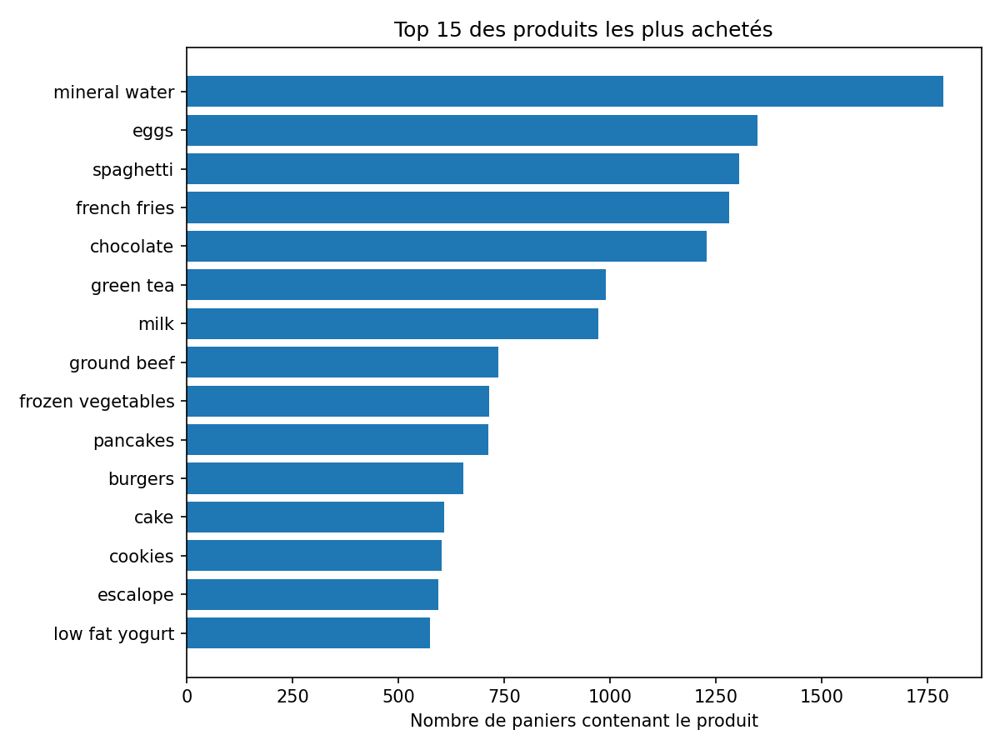
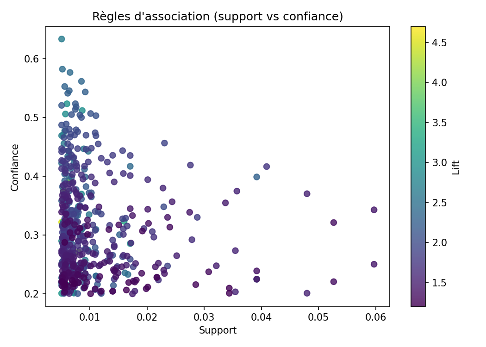

# Analyse des habitudes d'achat d'un supermarché (Apriori)

Analyse d'un jeu de données transactionnel pour identifier les produits fréquemment
achetés ensemble, grâce à l'extraction de **règles d'association** avec l'algorithme **Apriori**.

## Principe

- **Support** : part des paniers qui contiennent les produits (A et B).
- **Confiance** : parmi les paniers avec A, part de ceux qui contiennent aussi B.
- **Lift** : confiance / fréquence de B. Un lift > 1 signifie que A et B sont achetés
  ensemble plus souvent que par hasard.

Apriori est implémenté **from scratch** (Python, pandas) :
1. recherche des itemsets fréquents niveau par niveau, avec élagage (si un itemset est rare,
   tous ceux qui le contiennent le sont aussi),
2. génération des règles A → B filtrées par confiance et lift.

## Technologies

Python, pandas, Matplotlib

## Structure

```
market-basket-apriori/
├── data/              # jeu de données (non versionné)
├── market_basket.py   # chargement, Apriori, règles, graphiques
└── requirements.txt
```

## Données

Jeu de données Kaggle « Market Basket Optimisation » (~7500 paniers de supermarché).
Placer le fichier dans `data/market_basket.csv`. Le script gère aussi le format
« Groceries dataset » (colonnes `Member_number`, `Date`, `itemDescription`).

## Utilisation

```bash
pip install -r requirements.txt
python market_basket.py
```

Les seuils se règlent en options :

```bash
python market_basket.py --min-support 0.01 --min-confidence 0.3 --min-lift 1.5 --top 15
```

## Résultats

| Si le client achète | Il achète aussi | Support | Confiance | Lift |
|---|---|---|---|---|
| pasta | escalope | 0.006 | 0.37 | 4.70 |
| pasta | shrimp | 0.005 | 0.32 | 4.51 |
| whole wheat pasta | olive oil | 0.008 | 0.27 | 4.12 |
| herb & pepper, spaghetti | ground beef | 0.006 | 0.39 | 4.00 |
| herb & pepper, mineral water | ground beef | 0.007 | 0.39 | 3.98 |
| tomato sauce | ground beef | 0.005 | 0.38 | 3.84 |
| mushroom cream sauce | escalope | 0.006 | 0.30 | 3.79 |
| frozen vegetables, spaghetti | tomatoes | 0.007 | 0.24 | 3.50 |
| mineral water, soup | olive oil | 0.005 | 0.23 | 3.42 |
| spaghetti, tomatoes | frozen vegetables | 0.007 | 0.32 | 3.34 |

Seuils utilisés : support ≥ 0.005, confiance ≥ 0.2, lift ≥ 1.2 (top 10 trié par lift).





## Interprétation

- Les clients qui achètent des **pâtes** achètent environ 4,5 à 4,7 fois plus souvent de l'**escalope** ou des **crevettes** que la moyenne (lift 4.70 et 4.51).
- Plusieurs règles associent des ingrédients de plat de pâtes (sauce tomate, herbes et poivre, spaghetti) au **bœuf haché** : ces produits pourraient être placés à proximité en rayon ou proposés en promotion croisée.
- Les supports sont faibles (0,5 à 0,8 % des paniers, soit environ 40 à 60 paniers) : ce sont des associations repérées dans les données, pas des relations de cause à effet, à valider avant toute décision commerciale.

## Pistes d'amélioration

- Comparer avec FP-Growth (plus rapide sur de gros jeux de données)
- Ajouter d'autres métriques (leverage, conviction)
- Visualiser les règles sous forme de graphe de produits
